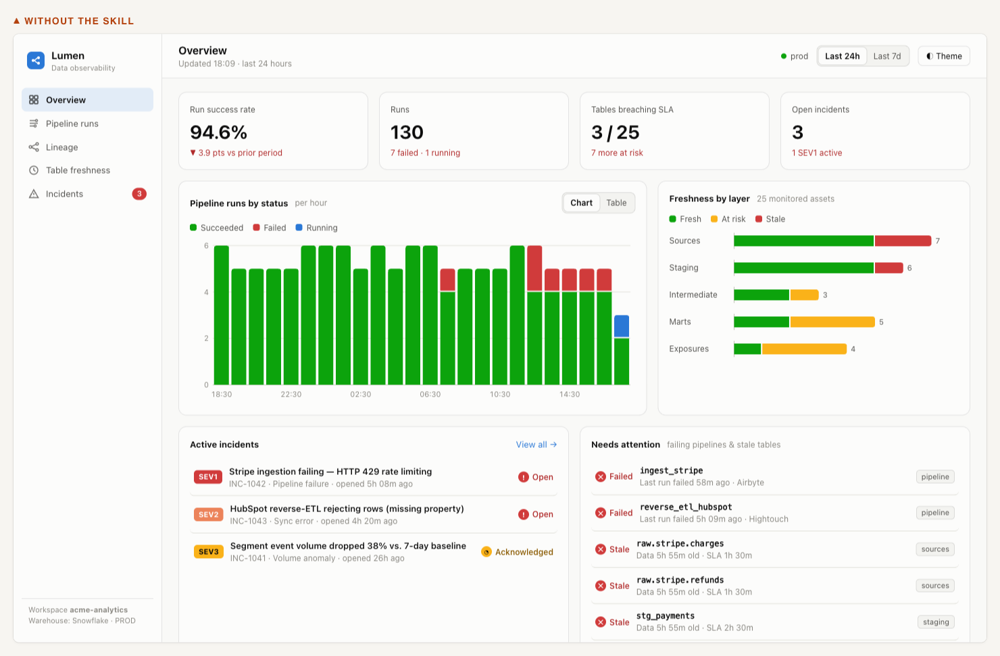
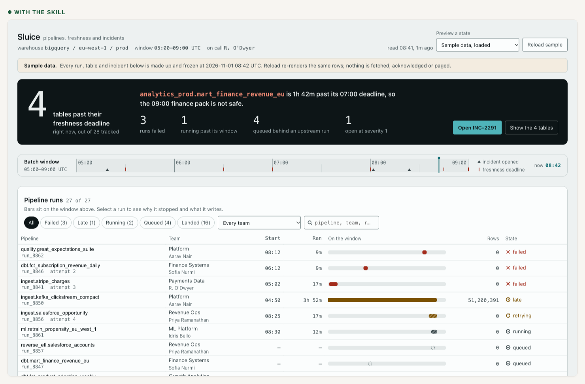

# ui-skills

Three agent skills for Claude Code. They make a coding agent decide what a
screen is for before writing it. They write the design system down before
building against it. They open the running product before calling it done.

The problem is not that an agent cannot write frontend code. It is that an
agent writes the ticket rather than the product. It satisfies the words of a
request, never opens the result, and ships a screen that is correct and
forgettable.

| Skill | Say | What it does |
|---|---|---|
| `ui-design` | "Make the pipeline health screen modern" | Writes `DESIGN.md` when the project has none, deals three directions and gets one picked, builds a mock when you want one, then builds the real thing |
| `ui-find` | "Find me a timeline component with expandable logs" | Searches the project, then 508 registries, reads the real code and the real licence |
| `ui-review` | "Audit this dashboard" | Measures the live render or the Storybook, walks the journey, checks it against your design principles. Changes no files unless asked |

## What ui-design does

Eleven stages that scale to the size of the change. A copy edit runs three of
them. A new surface runs all eleven, with the direction approved before any
code is written.

| | |
|---|---|
| 0 to 1 | Read what exists. Find or write `DESIGN.md`, and gate it with `pnpm dlx @google/design.md lint` |
| 2 to 3 | Name the business outcome and criteria checkable in a browser. Deal three visual directions and stop for the user to pick one |
| 4 to 5 | Map the journey and every state a single fixture hides. Search 508 component registries before writing a component |
| 6 to 7 | Mock or build direct. Build against the gates and the craft rules, most important screen alone and first, reviewed cold |
| 8 to 9 | Start the application, walk it as the customer with real clicks and typing, measure, fix in severity order, check for regressions |
| 10 | Report what was verified, by what means, and what was not |

Two of those stages are hard stops. The agent does not build past the
direction nobody picked, and does not call a mock finished without being told.

## The same prompt, with and without the skill

> Build a data platform observability console. It should show pipeline runs,
> data lineage, table freshness, and incidents.

That prompt, twice. Same model. Once on a stock install, once with
`ui-design`.





Measured in a browser at 1440: contrast failures 23 to 0, text under 12px 47
to 0, console errors 1 to 0. The method, the rest of the numbers, and the one
measurement that went the other way are in
[docs/ab-test.md](docs/ab-test.md).

## Component discovery

Search the project first, then 508 shadcn-spec registries, with no account
and no MCP server:

```bash
node .claude/skills/ui-design/scripts/find-components.js \
  timeline stepper activity --limit 10
```

```
@uiarc     timeline   13  not stated on the site's pages that were read
    Follow what happened, newest first, grouped by day.
   deps: lucide-react, motion; files: 2
    read: pnpm dlx shadcn@latest view @uiarc/timeline
@reui      timeline   13  MIT
   deps: @base-ui/react, cn; files: 1
    read: pnpm dlx shadcn@latest view @reui/timeline
searched 24 registries for: timeline, stepper, activity
licences marked "check at the source" were not read; read one before shipping a component
```

The score is a text match, not a judgement. Candidates are then read: their
real code, states, keyboard handling, dependencies and licence. They are
ranked by fit, licence, stack, design system, accessibility and install cost,
in that order. A licence that is not stated anywhere is a blocker, not a
footnote.

## The design system comes first

A review with no stated principles is taste, and taste loses arguments. So
`ui-design` writes the principles down before it builds, into one `DESIGN.md`
at the project root, and `ui-review` measures against that file.

Two layers. Tokens in YAML, which the linter and the Tailwind export read.
Then ten prose sections, carrying what tokens cannot: the mood, the
guardrails, what happens at a phone width, and the brief a future agent
gets.

```bash
pnpm dlx @google/design.md lint DESIGN.md      # broken refs, missing primary,
                                          # any colour pair below 4.5:1
pnpm dlx @google/design.md export --format css-tailwind
```

Two routes in. Where the project already has tokens, a theme or a live
product, the file **records what is there**. Values come out of the code, or
off the rendered page as computed values. Never estimated from a screenshot.
Where there is nothing, the file is a proposal, and stays marked as one until
the user picks a direction.

## Install

```bash
git clone git@github.com:Dhodraj/ui-skills.git
cp -R ui-skills/.claude/skills/* ~/.claude/skills/
```

Or copy the three skill folders into any project's `.claude/skills/`.

Needs Node 20 or newer. Network for registry search, which falls back to a
cached `--curated-only` search without it. A Playwright MCP server for stages
8 and 9. Without one, renders fall back to headless Chrome, and every journey
claim is reported unverified.

Full instructions: [docs/install-and-invoke.md](docs/install-and-invoke.md).

## What is in here

```
.claude/skills/
  ui-design/                        the entry point, 11 stages
    references/
      design-system.md              the DESIGN.md format, and both routes in
      gates.md                      the floor, in three tiers
      craft.md                      the layer above the floor
      directions.md                 dealing three, and the approval gate
      product-thinking.md           outcome, customer, evidence vs invention
      journey-and-states.md         the states one fixture hides
      playwright.md                 browser mechanics
      regression.md                 telling your failures from existing ones
    scripts/                        registry search, page measurement, validation
    tests/                          36 offline tests, 39 with --network
  ui-find/                          natural language to a real component
  ui-review/                        measure, walk, judge against the system
docs/                               research, architecture decision, testing
                                    report, examples, maintenance
demo/                               what the skill produced, and the two
                                    earlier states of it
```

Look at the demo yourself:

```bash
cd demo && python3 -m http.server 8731
# then open http://127.0.0.1:8731/console.html
```

`demo/console-plain.html` is the same console before the craft pass. Put them
side by side.

## Limits

- The gates and the craft rules are instructions, not mechanisms. An agent
  that skips those files still passes every automated check. `DESIGN.md` is
  the only part with a linter behind it.
- Nothing can force the three directions to differ on a real axis. Three
  shades of one idea would pass the stage.
- The Storybook path in `ui-review` has not been run against a real
  Storybook.
- `pnpm dlx @google/design.md lint` has not been run against a file these
  skills generated. The one at `demo/ab/with-skill/DESIGN.md` was written
  without network access.
- No component has been installed into a project through `ui-find`, and no
  application with a dev server, sign-in and live data has been driven.
- Walking a journey is not customer research. It finds friction. It says
  nothing about what customers do.

Every figure, run, depot and customer in `demo/` is sample data, and the pages
say so on their own face.

## Licence

MIT. [NOTICE](.claude/skills/ui-design/NOTICE) lists every source adapted,
with its licence. No file from any of them is copied.
