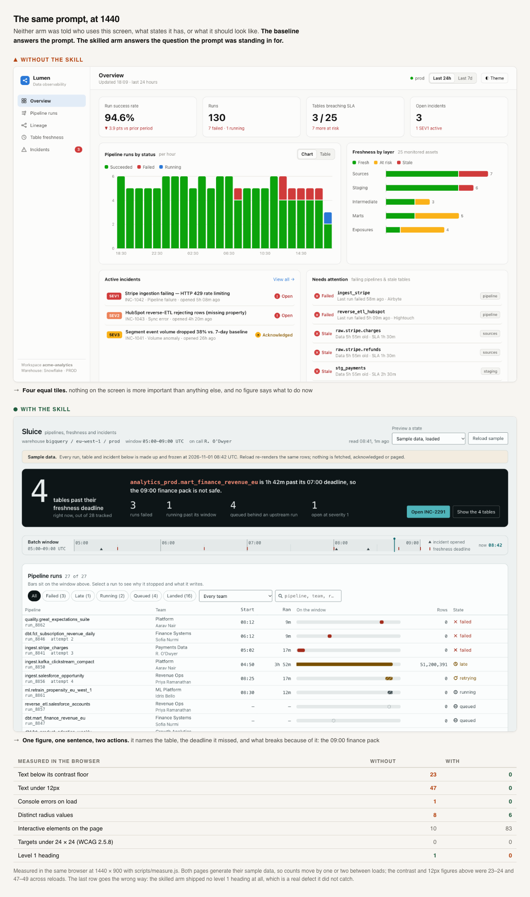
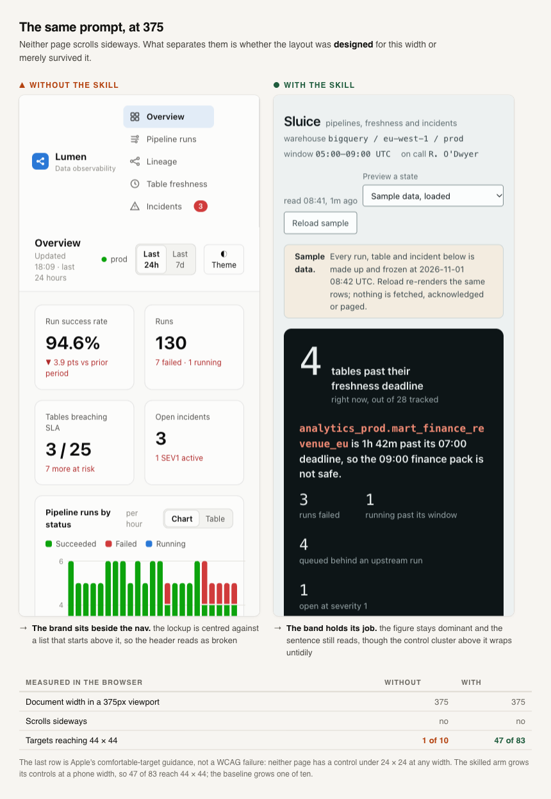

# The same prompt, with and without the skill

## The prompt

Word for word, to both:

> Build a data platform observability console. It should show pipeline runs,
> data lineage, table freshness, and incidents.
>
> Write it as one self-contained HTML file. Inline all CSS and any
> JavaScript. No build step, no external network requests, no CDN links, no
> web fonts fetched over the network. It must open directly in a browser and
> render fully offline.

No audience. No states. No design direction. No acceptance criteria.

## The two arms

| | Baseline | With the skill |
|---|---|---|
| Started with | `claude --safe-mode`: no CLAUDE.md, no skills, no plugins, no hooks, no MCP servers | The same, plus `ui-design` and its reference files |
| Model | opus | opus |
| Could look at its own render | No. A fresh install has no browser tooling | Yes |
| Could ask anything | No | No |

Both builds are in this repository: `demo/ab/stock/index.html` and
`demo/ab/with-skill/index.html`, with the design system the skilled arm wrote
at `demo/ab/with-skill/DESIGN.md`.

## Measured at 1440

Both pages served over `127.0.0.1` and measured in one browser session with
`scripts/measure.js`.

| | Baseline | With the skill |
|---|---|---|
| Text below its contrast floor | 23 | **0** |
| Text under 12px | 47 | **0** |
| Console errors on load | 1 | **0** |
| Distinct radius values | 8 | **6** |
| Interactive elements | 10 | 83 |
| Targets under 24 × 24 | 0 | 0 |
| Level 1 heading | 1 | **0** |

The last row goes the wrong way: the skilled arm shipped no level 1 heading.

Worst baseline contrast was 3.5:1 where 4.5:1 is required, on the product
name and the workspace label. Both pages generate their sample data. Counts move by one or two between
loads: contrast ran 23 to 24, the 12px count 47 to 49.

## Target sizes

`measure.js` returns one `smallTargets` count that merges two different
things. Under 24 × 24 is a WCAG 2.5.8 failure. Under 44 × 44 is Apple's
comfort guidance. Split:

| | Baseline | With the skill |
|---|---|---|
| Under 24 × 24, at either width | 0 | 0 |
| Reaching 44 × 44 at 1440 | 0 of 10 | 0 of 83 |
| Reaching 44 × 44 at 375 | 1 of 10 | 47 of 83 |

Neither page has a WCAG target failure.

## At 375

Neither page scrolls sideways. Document width is 375 in both.

## What the measurement does not reach

The baseline reports four equal figures: a success rate, a run count, a breach
count, an incident count. Nothing is larger than anything else.

The skilled arm names one figure and the consequence behind it:

> **4** tables past their freshness deadline.
> `analytics_prod.mart_finance_revenue_eu` is 1h 42m past its 07:00 deadline,
> so the 09:00 finance pack is not safe.

Then two actions, and one time axis every panel hangs off.

Reviewing before it finished, the skilled arm found eight false statements in
its own interface:

- the incident summary counted a mitigated incident as resolved;
- an incident was marked mitigated while its run was still degrading;
- a table showed a green "landed" state while lineage called the same table
  stale input;
- an incident title claimed six days against a five-hour span;
- a warning triangle sat permanently on a fresh timestamp;
- a table showed 0 rows and 0 partitions beside a load time;
- "queued behind a failure" was true of one run in four;
- acknowledge permissions did not follow the on-call the page itself stated.

No linter reports any of those.

## Scope

One prompt, one run each, one model. Not an average and not a benchmark.
